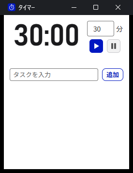

# 集中タイマー

付箋のようにデスクトップの片隅に置いて使う、Windows 向けの小さなタイマーです。作業時間と、その時間でやることを一緒に確認できます。

時間は分単位で指定し、開始・一時停止できます。計測終了時には音で知らせます。また、休憩後などに開始を忘れたことに気づけるよう、停止が5分続くと色の変化と音で知らせます。

タスクはチェックリストとして追加でき、文章をクリックして編集できます。残り時間を大きく表示し、コンパクトな画面で時間の確認と操作ができることを重視しています。

Windows 版では、右クリックメニューから最前面表示・通知音の切り替えやタイマーのリセットができます。



## ダウンロード

[Releases](https://github.com/paruma/timer202611/releases) から Windows 版の ZIP をダウンロードし、展開して `focus-timer.exe` を実行してください。

## Windows 版の作成

利用対象は Windows です。Windows PowerShell でプロジェクトのルートから次のコマンドを実行してください。

```powershell
powershell -NoProfile -ExecutionPolicy Bypass -File .\scripts\windows.ps1 -Run
```

Windows 側の Rust と Microsoft C++ Build Tools を使い、`%TEMP%\timer202611-windows-build` でビルドします。生成した実行ファイルはプロジェクトの `windows-app\focus-timer.exe` にもコピーします。`-Run` を省略するとビルドだけ行います。ソースが WSL 内にあっても使用できます。

## 開発用の起動

Windows 側に Node.js（LTS 推奨）、pnpm 12.15.0、Rust（stable・MSVC 版）、Microsoft C++ Build Tools の「C++ によるデスクトップ開発」、WebView2 が必要です。導入手順は [Tauri の前提環境](https://v2.tauri.app/start/prerequisites/)を参照してください。pnpm は `npm install --global pnpm@12.15.0` で導入できます。

Windows 側のターミナルで、プロジェクトのルートから次のコマンドを実行してください。

```sh
pnpm install --frozen-lockfile
pnpm run desktop
```

## 配布用ビルド

配布用の ZIP は GitHub Actions で生成します。`1.2.3` のようなバージョンタグを付けると、Windows 版をビルドし、実行ファイル・第三者ライセンス・対応ソースをまとめて Releases に公開します。

配布時は、ライセンス表記と対応ソースを含む ZIP 一式を使ってください。

## 画面の編集

変更後は `pnpm run check` で、HTML 内の JavaScript と `scripts/*.mjs` の構文・未定義変数などを検査できます。同じ検査を Windows ビルドの CI でも実行します。画面の見た目や操作は別途確認してください。

依存パッケージは `pnpm-workspace.yaml` の設定で、公開から7日以上経過したバージョンに制限しています。条件を満たすバージョンがない場合や公開日時を確認できない場合は、インストールを失敗させます。

画面のソースは `timer.html` です。起動・ビルド前に `scripts/prepare-frontend.mjs` がこのファイルを `dist/index.html` へコピーします。

ブラウザ版は `timer.html` を直接開いて使えます。HTML の変更は再読み込みで反映されます。

デスクトップ版では HTML を実行ファイルに組み込むため、変更を反映するには再ビルドが必要です。`pnpm run desktop` で開発している場合は、このコマンドを実行し直してください。Windows 版の実行ファイルを更新する場合は、アプリを閉じてから `scripts/windows.ps1 -Run` を実行してください。
